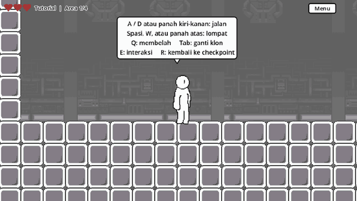
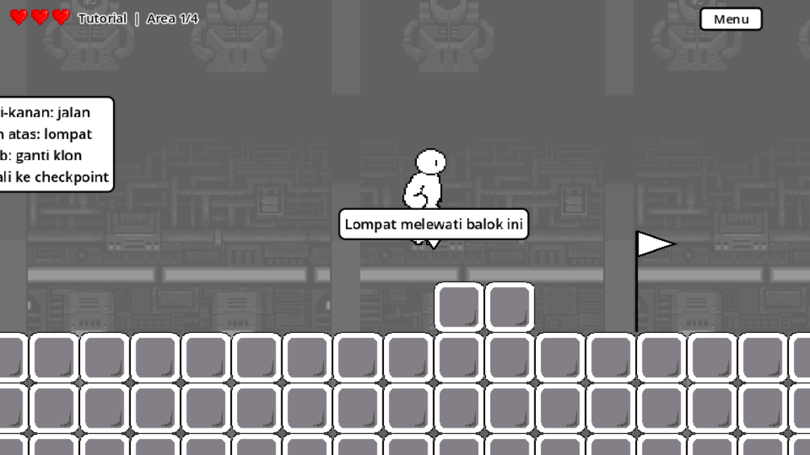
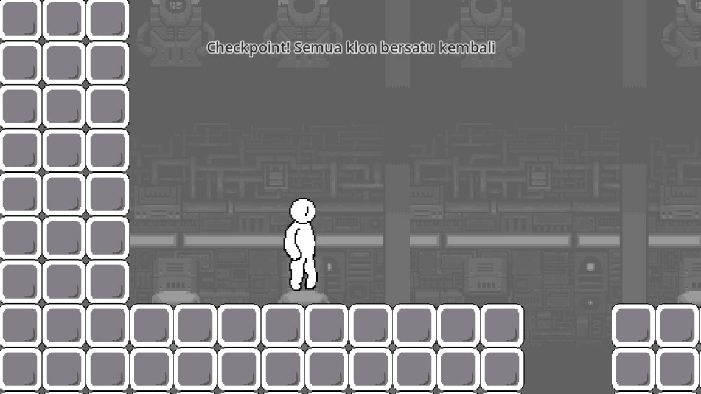
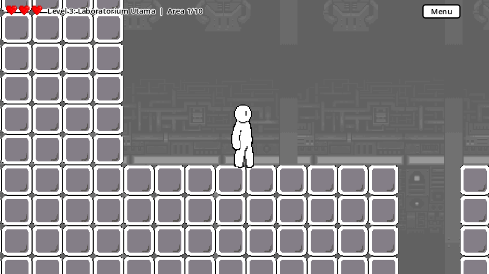
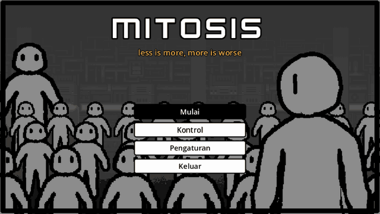

<div align="center">



<br>

<a href="https://github.com/muhammadalhaffaf-hue/mitosis/releases/latest"></a>
<br><br>


<br><br>

**One body. Too many problems. Split yourself to solve them, but every split makes you weaker.**



</div>

---

## 🧫 About

You are a small white test subject trapped in an abandoned grey laboratory. Your one trick is **mitosis**: press a key and you split into two smaller copies of yourself.

Two of you can hold a button *and* walk through the door it opens. Four of you can stand on four switches at once. But the theme bites back: every split cuts your size, your jump height and your strength. Small clones can't push heavy boxes, can't hold back the robot dog, and can't reach high ledges.

**Less is more. More is worse.** Work out how many of you each room really needs.

## 🎮 Controls

| Key | Action |
|:---:|---|
| <kbd>A</kbd> <kbd>D</kbd> / <kbd>←</kbd> <kbd>→</kbd> | Walk |
| <kbd>Space</kbd> / <kbd>W</kbd> / <kbd>↑</kbd> | Jump |
| <kbd>S</kbd> / <kbd>↓</kbd> | Drop through thin platforms |
| <kbd>Q</kbd> | **Split** into two clones |
| <kbd>Tab</kbd> | Switch to another clone |
| <kbd>E</kbd> | Merge with a nearby clone · hold back the robot dog |
| <kbd>R</kbd> | Return to the last checkpoint |

## 🧬 How splitting works

```text
            ┌───────────┐
            │   LARGE   │   highest jump · pushes any box · holds the robot dog
            └─────┬─────┘
          Q       │       Q
      ┌───────────┴───────────┐
┌─────┴─────┐           ┌─────┴─────┐
│  MEDIUM   │           │  MEDIUM   │   lower jump · pushes medium boxes
└─────┬─────┘           └─────┬─────┘
   ┌──┴──┐                 ┌──┴──┐
 SMALL SMALL             SMALL SMALL     tiny jump · fits through narrow gaps
```

- Clones can **stand on each other** to reach higher ledges.
- If a clone dies while others survive, you lose a ❤️ and its twin grows back.
- **Checkpoints** merge every clone back into one full-size body.

<details>
<summary><b>🧪 Things that will try to stop you</b></summary>
<br>

| Object | What it does |
|---|---|
| 🔘 **Buttons** | Open doors only *while pressed*. Leave a clone (or a box) on them. Some doors need several buttons at once. |
| 🚪 **Lab doors** | Slide open when their buttons are held. A speech bubble tells you which button is missing. |
| 📦 **Boxes** | Push them onto buttons. Heavy boxes need a big body. |
| 🛗 **Lifts** | Ride up while their button is held. |
| 🐕 **Robot dog** | Patrols and kills on touch. Only the largest body can hold it still with <kbd>E</kbd>. |
| 🏹 **Arrow traps** | Fire across the room on a timer. |
| 🔥 **Fire traps** | Burst in waves. Time your run. |

</details>

## 🗺️ Levels

<table>
<tr>
<td width="33%" align="center"><br><b>Tutorial</b><br><sub>Learn to split, switch and merge</sub></td>
<td width="33%" align="center"><br><b>Level 1 · Lab Bawah</b><br><b>Level 2 · Jalur Lift</b><br><sub>Long multi-room runs: lifts, boxes, pits, fire, arrows</sub></td>
<td width="33%" align="center"><br><b>Level 3 · Laboratorium Utama</b><br><sub>The main lab: a 10-area chain of buttons ending at the elevator</sub></td>
</tr>
</table>

<div align="center">

</div>

## ▶️ Play

**Windows:** grab `MITOSIS.exe` from the [latest release](https://github.com/muhammadalhaffaf-hue/mitosis/releases/latest) and run it. No install needed.

**From source:**

1. Install [Godot 4.7](https://godotengine.org/download).
2. Clone this repo and open `project.godot` in Godot.
3. Press <kbd>F5</kbd>.

<details>
<summary><b>🛠️ For developers</b></summary>
<br>

```text
Scenes/        scenes and scripts (characters, buttons, doors, traps, levels)
  permainan.gd   autoload: levels, HUD, hearts, checkpoints, pause and win panels
  suara.gd       autoload: sound effects and music
  karakter.gd    the player and the split / merge logic
Assests/       sprites, tiles, fonts and audio (each with its license file)
tests/         headless bot tests that play through every level
docs/          README images
```

Run the automated tests (bots walk, split and solve every room):

```bash
godot --headless --path . --script res://tests/uji_level.gd
godot --headless --path . --script res://tests/uji_seluruh_level.gd
godot --headless --path . --script res://tests/uji_mekanik.gd
```

A designer-facing guide to every mechanic (in Indonesian) lives in [`PANDUAN_MEKANIK.md`](PANDUAN_MEKANIK.md).

</details>

## 🙏 Credits

Made by a team of three for a game jam with the theme **"less is more, more is worse"**.

Third-party assets, all free to use:

| Asset | Author | License |
|---|---|---|
| [Warped Sci-Fi Lab](https://ansimuz.itch.io/) background | ansimuz | Free, redistribution allowed |
| [Sideview Sci-Fi Patreon Collection](https://opengameart.org/content/sideview-sci-fi-patreon-collection) (elevator) | ansimuz | CC0 |
| [Scifi Door sprite](https://opengameart.org/content/scifi-door-sprite) | davididev | CC0 |
| [Meca Dog](https://opengameart.org/content/meca-dog) | Blind Harpy Gamedev | CC0 |
| [Pixel Trap Pack](https://foozlecc.itch.io/) | Baldur / Foozle | CC0 |
| [Simple Pixel Hearts](https://opengameart.org/content/simple-pixel-hearts) | OpenGameArt | CC0 |
| [Dark Sci-Fi Audio Pack](https://opengameart.org/comment/112658) (music) | SRG774 | CC0 |
| Interface, Impact and Sci-Fi Sounds · [Kenney Fonts](https://kenney.nl/assets/kenney-fonts) | [Kenney](https://kenney.nl) | CC0 |

<div align="center">
<br>
<sub>Split wisely. 🧫</sub>
</div>
